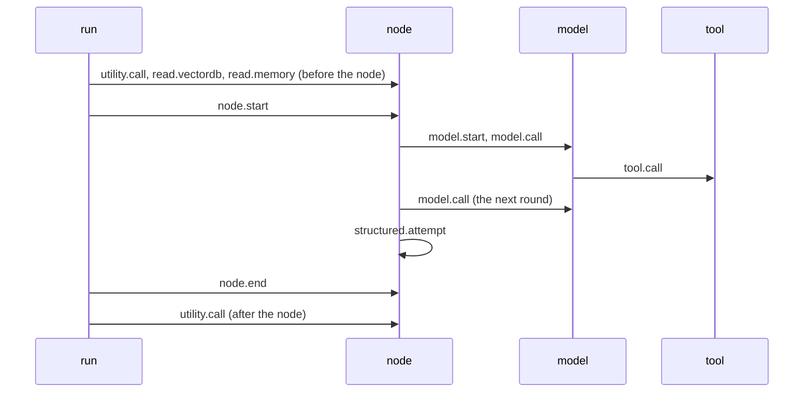

# Agents and software

Solving a problem with agents and solving a problem of software are two different jobs, and whoever does the first
should not be forced to do the second. Whoever designs a system of agents decides which models to use, what each one
reads, with which instructions, in which order they work and through which patterns, and who judges the result of
whom. Whoever writes the software that runs them deals with tools, utilities and everything that belongs strictly to
software.

In the most common agent libraries the two jobs sit in the same code, and the design of the system of agents ends up
buried under that of the software. a-graph keeps them apart: the problem of the agents is written in a YAML file, the
problem of the software is solved by the engine, the program a-graph, and by separate pieces of software that solve
specific problems: the utilities, which change the data of a node, and the tools, which the model calls.

```mermaid
flowchart LR
    subgraph file["The YAML file: the agents"]
        direction TB
        f1[models and what each node reads]
        f2[prompts]
        f3[nodes and edges: the order and the patterns]
        f4[judges]
    end
    subgraph engine["The engine: a-graph"]
        direction TB
        p1[the API of each provider]
        p2[structured output and its checks]
        p3[batch jobs]
        p4[hosts, secrets, contents of the log]
        p6[log, trace, display]
    end
    subgraph own["Separate software"]
        direction TB
        u1[utilities: change the data of a node]
        t1[tools: called by the model]
    end
    file --> engine
    engine -- JSON contract --> own
```



## An example

[`examples/02-sequence`](../examples/02-sequence/graph.yml) translates a text into Italian, then shortens the
translation. Its graph is:

```yaml
graph:
  nodes:
    - id: translator
      model: { id: local, reasoning: off, max_tokens: 300, temperature: 0 }
      resources: { prompt: translate }
      message:
        input: { user_message: true }
        output: { assistant_message: true, node: true }
    - id: shortener
      model: { id: local, reasoning: off, max_tokens: 300, temperature: 0 }
      resources: { prompt: shorten }
      message:
        input: { agent_message: true }
        output: { assistant_message: true }
  edges:
    - start: translator
    - end: shortener
```

The file says nothing of how the API of Ollama is called, of how the text goes from one node to the other, or of what
happens if the provider does not answer: it holds only the tasks of the nodes and their order. No node knows its
neighbours: the links are made by the edges alone (see [nodes](nodes.md) and [edges](edges.md)).

## The patterns

A few constructs of edges and nodes express the usual patterns of systems of agents:

- **Pipeline**: each node works on the result of the one before: `start`, some `next`, `end`.
- **Fan-out and fan-in**: a group has an `in` node, branches (`fan`) and, if needed, an `out` node, which receives the
  answers of all the branches packed as one. The four groups differ only in how the branches run: one after the
  other (`linear`), all together (`parallel`), at most `limit` at a time (`concurrent`), or as batch jobs of the
  provider (`batch`). A branch can be a group or a `react`, so groups nest (see [edges](edges.md#groups)).
- **Controller and workers**: in a `react` a controller chooses at every turn which worker to call, with which input,
  until its final answer, within `max_iterations` calls. It is the only construct where the order of the work is
  decided at run time instead of in the file (see [edges](edges.md#react)).
- **Judge**: a validation node judges a result by the criterion of its prompt. Approved, the message goes on
  unchanged; refused, the run stops (`on_error: stop`) or the reasons go to the next node (`on_error: node`) (see
  [nodes](nodes.md#validation-nodes)).
- **Retrieval**: a node searches its vector databases, and the chunks found go into its prompt as `{{chunks}}` (see
  [vector databases](vectordb.md)).
- **Memory**: a memory keeps the exchanges of a node between runs and has them summarized by a model (see
  [memory](memory.md)).
- **Blackboard**: a Markdown text one node writes and another reads later (see [blackboards](blackboards.md)).
- **Structured output**: a node with a schema answers a JSON value, which the program checks before it goes on (see
  [nodes](nodes.md#where-the-answer-goes)).

## The side of the software

What the file does not say is done by a-graph, once for every graph:

- **The providers.** The file asks for a level of reasoning, an output schema, logprobs; the program writes them in
  the form of each provider and, when a level does not exist, uses the nearest one. What a model cannot do is an
  error when the file is checked, before any call (see [models](models.md)).
- **Structured output.** The program enforces the schema through the API of the provider (`schema`) or, for the
  models that ignore it, through the prompt, asking again when the answer is not one JSON value (`schema_prompt`).
  Either way the answer is read and checked against the schema in the same way for every provider.
- **Batch.** `batch` written in place of `parallel` is enough: the program creates the jobs, polls them until they
  end, tries again the readings that fail, and cancels them at the provider when the run is stopped (see
  [models](models.md#batch)).
- **Security.** The file holds no secrets, only the names of the variables that hold them. The hosts it may reach
  are in its `passport`, and every destination of the file is checked before anything runs. The log and the trace
  hold the contents of the messages only if the data classification of the passport allows it (see
  [the file](file.md)).
- **Your own software stays out of the graph.** A tool is a program or a service with a small JSON contract (see
  [tools](tools.md)); a utility changes the data of a node before or after the model, without the model knowing (see
  [utilities](utilities.md)). The graph knows only that they exist and the data they work on.

Since the problem of the agents is written whole in the file, the file is checked whole before anything runs: the
keys, the ids, the links, what the models can do, the agreement between prompts and nodes, the hosts, the variables.
`a-graph --check graph.yml` does only that (see [the command line](cli.md)). For the same reason the
[service](serve.md) can read a graph sent from outside and refuse it, before it builds anything, if it would start a
program, touch a file outside the folder of its session or reach a host it does not allow.

## Observability

Observability comes from the benchmarks themselves: the ability to measure the stability of each agent, where it
fails, and why.

Each node is a unit of the run, with its own events (see [observability](observability.md)):

- `node.start` and `node.end`: its model, its tokens, its duration, why its answer ended (`stop`), the `verdict` of a
  judge, and how many corrections its answer needed;
- `model.call`: each call to its model, with the prompt, the answer and the reasoning as the passport allows;
- `tool.call`: each call to a tool, an MCP server or a skill, and whether it failed;
- `structured.attempt`: each answer checked against a schema, with its `outcome` and what the check found;
- an error, with the node and the rule that stopped the run, and what caused it as the passport allows.

The same events go to the log, to the trace, where every node and every call is a span with its real start and
duration, and to the display. The final output has one item for each node that sends to it, with its reasoning and
its logprobs when the node asks for them (see [the command line](cli.md#the-result)).


