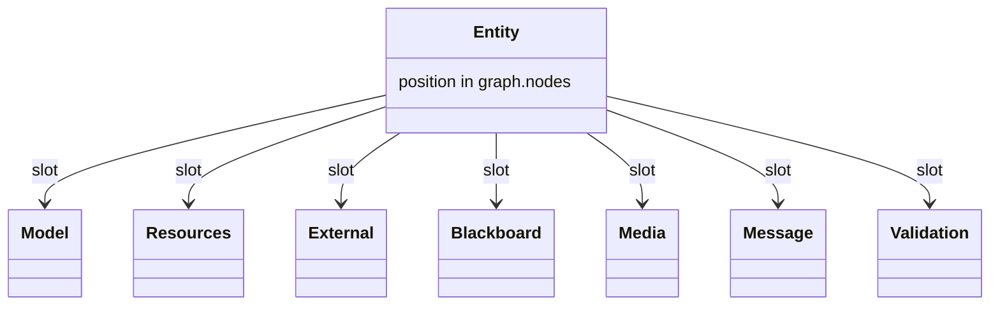
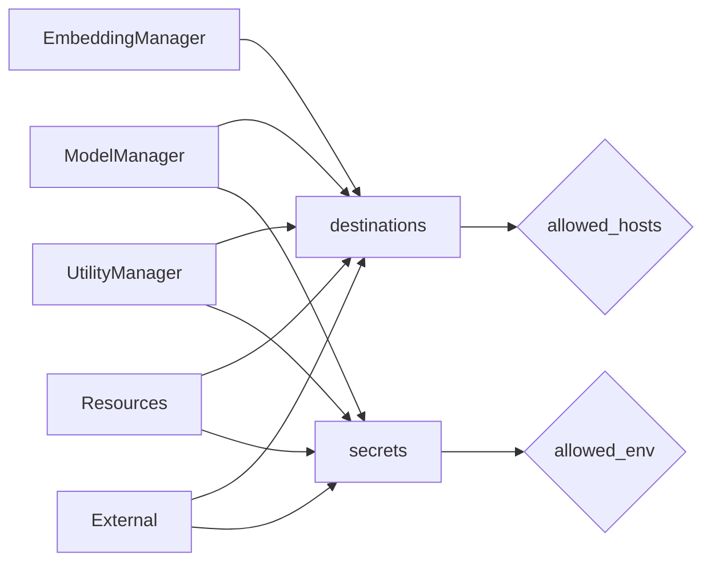
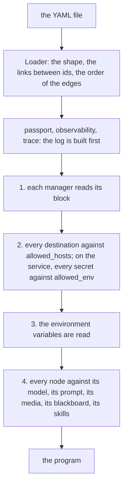

# The architecture

a-graph is built on the Entity Component System pattern. The nodes of the graph are entities, what a node has is
held in components, and every other block of the file is built by a manager of its own. This page explains how the
parts fit together; what each block does is on its own page (see [the documentation](README.md)).

## Entities and components

A node is an entity: only its position in `graph.nodes`. Its `id` leads to it. What the node has is held in
components, which are pure data, one type for each block a node can have. Each kind of component has its own store,
with one slot for each entity: the slot is empty when the node does not have that block. The set of components is
closed:

| Component | Block of the node | What it holds |
|---|---|---|
| `Model` | `model` | the model the node is bound to, and the parameters of its calls |
| `Resources` | `resources` | the prompt, the tools, the MCP servers, the skills, `max_rounds` |
| `External` | `external` | the vector databases, the search engines and the memories it uses |
| `Blackboard` | `blackboard` | its one blackboard: read, write, cleanup |
| `Media` | `media` | the media it reads and the media it produces |
| `Message` | `message` | where its text comes from and where its answer goes |
| `Validation` | `validation-node` | marks the node as a judge |

A validation node has the same components as a node, read from inside `validation-node`, and also `Validation`. A
node has no component for its role: it is a controller or a worker because it appears as one in a `react` (see
[edges](edges.md#roles)).

## Managers

Every block of the file that is not a node is built by its own manager, which reads only its block and checks the
rules of its content:

| Block | Manager |
|---|---|
| `models` | `ModelManager` |
| `embeddings` | `EmbeddingManager` |
| `utilities` | `UtilityManager` |
| `resources` | `Resources`: prompts, tools, MCP servers, media, skills |
| `external` | `External`: vector databases, search engines, memories |
| `blackboards` | `BlackboardManager` |
| `graph.nodes` | `Nodes`: the entities and their components |
| `graph.edges` | `Edges`: the order of the entities |

A manager does not check the network or the environment itself: it declares its destinations (the hosts it will
reach) and its secrets (the variables it will read, and where each goes). One module compares all the destinations
with `allowed_hosts`, and, on the service, one module compares all the secrets with `allowed_env`.

## From the file to the program

A file becomes a program in steps. Each step runs only when the one before found nothing, and all the errors of a
step are reported together and written in the log:

1. The Loader checks the shape of the file, the links between its ids and the order of the edges. A file that does
   not pass it is not built at all.
2. The passport and the log come first: a log `url` whose host is not allowed is reported alone, before the log is
   built, so it is never called.
3. Each manager reads its block. No environment variable is read yet.
4. Every destination is checked against `allowed_hosts`, and, on the service, every secret against `allowed_env`.
5. The environment variables are read: the models are made ready to be called, and so is the trace.
6. Every node is checked against what the managers can do: its model, the placeholders of its prompt, its media,
   its blackboard, its skills.

The program holds the log, the display, the trace, the managers, the nodes and the edges.

## The run

The edges are read in order, as a list (see [edges](edges.md)). Each node is run in two halves around the call to
its model: the first reads the components of its entity (the prompt, the media, the vector databases, the memories,
the blackboard) and prepares the call; the second delivers the answer where its `Message` says, writes and cleans its
blackboard, and saves its memories. Between them the model is called, with the loop of the tools (see
[nodes](nodes.md#the-run-of-a-node)).
