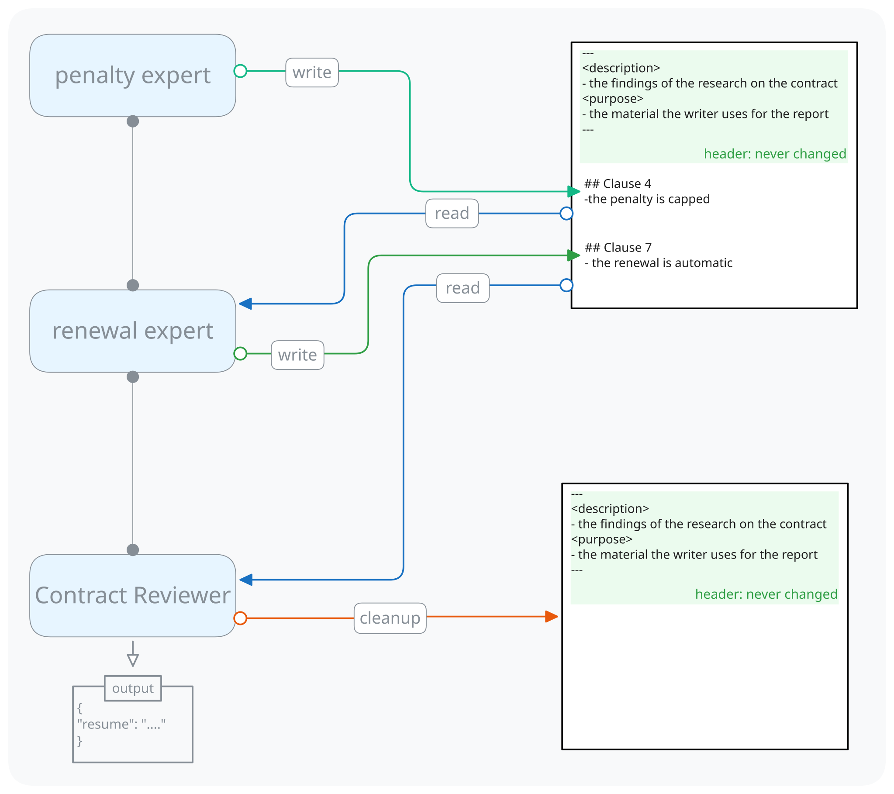

# Blackboards

A blackboard is a Markdown text shared by nodes: one node writes what it found, another reads it later. Blackboards
are declared in `blackboards`, each with an `id` and a `source`; a node uses one with its `blackboard` block. Every key
is described in [the reference](graph.md).



```yaml
blackboards:
  - id: findings
    source: { file: ./boards/findings.md }

graph:
  nodes:
    - id: researcher
      blackboard: { id: findings, write: { enabled: true, place: bottom } }
    - id: writer
      blackboard: { id: findings, read: true }
```

The content is always Markdown. The nodes never touch it directly: the program reads and writes it for them, as it
does with tools.

## Where it is kept

- `source: memory`: in the program. It starts empty and is lost when the run ends.
- `source: { file: <path> }`: a file. The file must exist when the graph file is checked, and must start with the
  header (below).
- `source: { url: ... }`: refused when the file is checked (`not_supported`). A board is written as well as read,
  and writing at a url is not defined.

## The header

A blackboard in a file starts with a header that you write, between two `---` lines, with a `<description>` and a
`<purpose>`, each followed by some text:

```markdown
---
<description>
the findings of the research on the contract
<purpose>
the material the writer uses for the report
---
```

The header is not a key of the graph file: it is part of the text of the blackboard. A file without it, or with a
header of another shape, makes the graph file invalid (`blackboard_header`). Reading the blackboard gives the whole
text, header included; writing and cleaning never change the header.

## Reading, writing, cleaning

A node manages one blackboard only: `blackboard` is a single block, not a list.

- `read: true`: the text of the blackboard goes into the prompt, where it writes ``, which is then
  mandatory (see [prompts](prompts.md)). With `read: false` the prompt cannot use that placeholder.
- `write: { enabled: true, place: top | bottom }`: after the node answers, its text is added below the header, at the
  top or at the bottom of what is already there, separated by an empty line. Writing needs no placeholder. The text is
  the one the node delivers, after the utilities of `message.output` and then of `write.utility`.
- `cleanup: true`: when the node is done, everything below the header is removed. It cannot be `true` together with an
  enabled `write`, because what the node wrote would be lost (`cleanup_write`).

Two nodes may write the same blackboard: the writes of a file are made one at a time, also between requests of the
service and runs of the command line that share the file. Each write or cleanup of a file holds an exclusive lock on
`<file>.lock`, a file left next to the blackboard, from the read of the blackboard to its write. The file is written in
one step (a temporary file of its own, then renamed), so a reader sees it before or after a write, never half of it. A
write or a cleanup of a file whose header is no longer valid is refused (`blackboard_header`) and leaves the file as it
is.
The new file keeps the permissions of the old one, its owner becomes the user of the process, and a hard link to the
old file keeps the old content. A write or a cleanup of a blackboard that is a symbolic link is refused (`io`) and
changes nothing: the yml names the file itself.
If the process dies between the write of the temporary file and its rename, the temporary file stays next to the
blackboard, and the blackboard stays as it was. Each temporary file has a random name, so one left behind does not
stop the next write.
