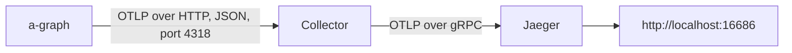

# Examples

The folder [`examples/`](../examples) holds three graphs that run with no key: they use a local
[Ollama](https://ollama.com) with the model `qwen3.5:4b`, at `http://localhost:11434`. Get the model once:

```
ollama pull qwen3.5:4b
```

Every graph of the folder is checked by the tests, from its own folder: a change that makes one invalid fails the
suite (`tests/examples/all_valid`).

## 01-hello: one node

[`examples/01-hello/graph.yml`](../examples/01-hello/graph.yml) is the smallest graph: one node, `assistant`, answers
the message of the user in one short sentence.

```
cd examples/01-hello
a-graph graph.yml "What is a mutex?"
```

- The prompt `answer` uses `{{user_message}}`, the message given on the command line (see [prompts](prompts.md)).
- The node takes the message of the user (`user_message: true`) and sends its answer to the result
  (`assistant_message: true`) (see [nodes](nodes.md)).
- A graph of one node is its `start` alone, with no `end` (see [edges](edges.md#the-main-flow)).
- `verbose: { level: steps }` shows the run and the node on the standard error as they go; `observability: { level:
  warn }` writes in the log only the problems (see [observability](observability.md)).

The result is one JSON document with one item, the answer of `assistant` (see
[the command line](cli.md#the-result)).

## 02-sequence: two nodes in a row

[`examples/02-sequence/graph.yml`](../examples/02-sequence/graph.yml) connects two nodes: `translator` translates the
message into Italian, `shortener` shortens the translation to at most ten words.

```
cd examples/02-sequence
a-graph graph.yml "A mutex is a lock that lets only one thread use a shared resource at a time."
```

- `translator` sends its answer both to the result and to the next node (`assistant_message: true, node: true`).
- `shortener` takes what the node before sends on (`agent_message: true`), and its prompt uses `{{agent_message}}`.
- The edges are `start: translator` and `end: shortener`: which node comes after which is said by the edges only,
  never by the nodes (see [edges](edges.md)).

The result has two items, in order: the translation, then its shortened form.

## 03-observability: a sequence and a react, in Jaeger

[`examples/03-observability`](../examples/03-observability/README.md) sends the trace of a run to an
[OpenTelemetry Collector](https://opentelemetry.io/docs/collector/), which passes it to
[Jaeger](https://www.jaegertracing.io/). It needs Docker with Compose, and is run from the root of the repository; its
README gives the commands.

Its graph is a sequence with a `react` in the middle: `framer` states the task, the controller `editor` calls the
workers `explainer` and `critic` until it is done, and `summarizer` shortens its final answer, which is the only item
of the result (see [edges](edges.md#react)).



- The graph has `trace: { endpoint: http://localhost:4318/v1/traces, capture_content: true }`: its passport says the
  data are `public`, so the prompts and the answers go into the trace, at most 4096 bytes each (see
  [observability](observability.md#the-trace)). Its `allowed_hosts` are the two ports it uses, `localhost:11434` and
  `localhost:4318`.
- `observability: { level: debug }` writes every event of the run, and `verbose: { level: off }` keeps the display
  away, so that the standard error holds only the JSON log.
- In Jaeger, under the service `observability` (the `name` of the passport), the trace of a run has one span for the
  run, `node framer`, `react` with `node editor` and a span for each worker it called, and `node summarizer`. Inside
  each node there is a span `model local` for each call to the model, and inside `node editor` a span
  `structured valid` for each routing answer it gave.
- The JSON log stays in a local file: it is not sent to the Collector. The `trace_id` of its records leads to the
  trace of the run in Jaeger.
- The Collector and Jaeger listen only on `127.0.0.1`, and Jaeger keeps at most 1000 traces in memory: restarting it
  loses them.

How many times the editor calls each worker is the choice of the model at each turn, within `max_iterations: 4`.
