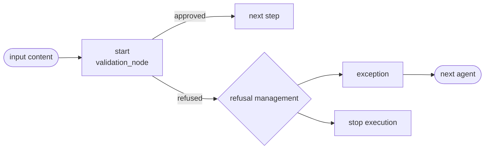

# Nodes

A node is a model plus what it uses (a prompt, tools, media, a memory...), where its input comes from and where its
output goes. Nodes are declared in `graph.nodes` and connected in `graph.edges` (see [edges](edges.md)). Every key is
described in [the reference](graph.md).

## Text and media

What a node receives and produces is split by its nature:

- `message` is text: `message.input` says where the text comes from, `message.output` where it goes;
- `media` is everything that is not text: `media.input` lists the media the node reads, `media.output` the media it
  produces (see [media](media.md)).

Every source and every destination is a separate `true` or `false`, and any combination is valid. Several can be
`true` at the same time; all can be `false`, for a node that works only with its other resources, or that is useful
only for what it does along the way (writing a blackboard or a memory, calling tools), and whose output is discarded.

## Where the text comes from

- `user_message: true`: the message of the user, the one given to the command.
- `agent_message: true`: what the node connected before sends on. Which node that is, is decided by `edges`, never by
  an id written on the node.

A node that takes a message that does not arrive (for example `agent_message` after a node that sends nothing on)
fails when it runs. How the two messages reach the prompt is explained in [prompts](prompts.md).

## The run of a node

1. The messages the node takes go through the utilities of `message.input.utility`, if any. The changed text is the
   one used from here on: in the prompt, in the queries to the vector databases and memories, and in what the memory
   saves. A message the node does not take is not changed: on a node that does not take the message of the user, a
   vector database with `query: user_message` searches with the message as the user wrote it.
2. The node reads what it declares: the vector databases (`{{chunks}}`), the memories (the history and the summary),
   the blackboard if it reads it, the media of `media.input`.
3. The placeholders of the prompt are filled, and the model is called.
4. If the model asks for tools, MCP tools or skills, they are called and the model is called again with their
   results, until it gives its final answer (see [tools](tools.md)). The loop has at most `resources.max_rounds` rounds
   (20 by default); one more fails the run. This loop is not part of `message`: from the point of view of the graph,
   the node gives only its final answer.
5. The answer is delivered.

## Where the answer goes

The text of the answer goes through the utilities of `message.output.utility` once, and then the same changed text
goes to every destination:

- `assistant_message: true`: to the final output (see [the command line](cli.md#the-result));
- `node: true`: to the node connected after, as its `agent_message`;
- the blackboard, if the node writes it, and the memories, according to their `write`.

`reasoning: true` adds the reasoning of the model to the final output. The reasoning never goes to another node.

`logprobs: <n>`, from 0 to 20, adds to the final output the log probability of every token of the answer, with the
`n` most likely alternatives of each token (0: only the token written). They never go to another node. They do not
depend on `assistant_message`: a node with `assistant_message: false` still puts an item in the final output, with no
message and with the tokens of its whole answer, as `reasoning` does. On `ollama` and `custom` a model that reasons
gives the tokens of its reasoning too, before those of the answer, even when the node has `reasoning: false`. Only
some providers give them (see [models](models.md#logprobs)); on the others the node is an error when the file is
checked (`not_supported`). They are kept for every call to the model, one list for each call, in order: a node with
tools has one list for each round of the tool loop and one for its final answer, which is the last list; the
controller of a `react` has one for each turn, and its tokens are those of the whole routing output, not only of its
`answer`. They are the tokens the model wrote: the utilities of `message.output.utility` change the text, not the
tokens, so the two may differ. A refusal has none. An answer with a text and no logprobs, as from a server that
ignores the request, stops the run (`model_failed`).

With an output `schema` (a JSON Schema written on the node), the model answers in that shape and the answer is a JSON
value instead of a text. A schema that is not a valid JSON Schema is refused when the file is checked (`bad_value`).
The schema reaches the model with its keys in the order they are written, and the JSON answer keeps the order the
model wrote. `ollama` and `openai` make the model write the fields in the order of the
schema: a field of reasoning written before the answer is written first. A node that has a
`schema` and goes through output utilities gives them the JSON as a text, and what they give back is a text.

The provider enforces the schema as far as its API does; a-graph then reads the answer itself, the same way for every
provider, and checks it against the schema. The answer is the whole text, or the whole content of the one code fence
(` ``` ` or ` ```json `) the text is made of; anything else around the JSON is not taken away. The run stops when:

- the answer is not one JSON value (a text, a text around the JSON, two values, a JSON left open by a model that ended
  by itself), or a JSON that does not match the schema: `schema_mismatch`;
- the model refuses: `model_refused`. Only some providers tell a refusal (see
  [models](models.md#what-each-provider-can-do)); with the others a refusal is a text like any other, and is read as
  one;
- the answer stopped before its end, at `max_tokens` or at the end of the context window, so its JSON is cut:
  `model_failed`, and the message says which of the two: at `max_tokens` it asks to increase `max_tokens`, at the end
  of the context window it says that the request exceeded it.

What the model wrote is the `detail` of the error, never its message. The verdict of a judge and the routing output of
a react controller are checked against their schema in the same way; their mechanism is the `structured_output` of
the validation node or of the `react`: `api` as `schema`, `prompt` as `schema_prompt`. With the API, the message of an
answer that is not one JSON value suggests the other mechanism: `schema_prompt` for a node,
`structured_output: prompt` for a judge or a controller.

### `schema_prompt`

Some models have no structured output in their API, or ignore it: Ollama's cloud models, for one. For them the node
writes its schema as `schema_prompt` instead of `schema`; never both (`unexpected_field`). The provider then gets no
schema: a-graph adds, at the end of the system prompt, a fixed text and the schema as it is written:

```
Answer with one JSON value only, with no text before or after it and no code fence.
The value must match this JSON Schema:
<the schema>
```

The answer is read and checked as with `schema`, with one difference: an answer that is not one JSON value (a text, a
text around the JSON, two values, a JSON left open by a model that ended by itself) is sent back to the model, after
everything else in the conversation, tool rounds included, with a fixed request to answer again with one JSON value
only. If the model then asks for a tool, the conversation keeps the order in which things happened: the wrong answer
and the correction, then that tool round. `max_attempts` (default 3, at least 1, only with `schema_prompt`) is the most calls for one answer, the first one
included; when the last one is not one JSON value either, the run stops (`attempt_limit`), with that answer as the
`detail`. Everything else is never corrected and stops the run as with `schema`: a JSON that does not match the
schema, a refusal, a cut answer. The wrong answers and the corrections are not the answer of the node: what goes on,
to the final output, to the next node and to the memories, is only the JSON. A node that calls tools may also have a
`schema_prompt`: the tools are called through the API as always, and only the final answer is checked. Every attempt
is a `structured.attempt` of the log (see [observability](observability.md)), and `node.end` counts the corrections.

Each produced media decides its own destinations with its `assistant` and `node`.

## Validation nodes



A validation node reads and judges, and produces nothing. It is a node of `graph.nodes` with an `id`, written with the
key `validation-node`:

```yaml
- id: check_answer
  validation-node:
    model: { id: fast, max_tokens: 1000 }
    resources: { prompt: criterion }
    message: { input: { agent_message: true } }
    structured_output: api
    on_error: stop
```

Its blocks have the same keys, in the same places, as those of a node, but only what it reads: `model`, `resources`
(only `prompt`, which is mandatory: the criterion of the judgment), `message.input`, `media.input`, `external`
(vector databases, search engines, memories) and `blackboard`. It reads the blackboard and the whole memory, both
roles, without writing them. It has no `tools`, `mcp_servers`, `skills`, `write`, `cleanup` or `output`.

Its answer has a fixed shape, `{ "validation": true | false, "reasons": "...", "log": "..." }`, which the model is
asked to follow. `structured_output` (mandatory) says how: `api`, through the API of the provider, as `schema` does
for a node; `prompt`, through the prompt, as [`schema_prompt`](#schema_prompt) does, with `max_attempts` (default 3,
at least 1, only with `prompt`).

- Approved: the message it received from the node before goes on to the next node unchanged, whatever its
  `message.input` reads. As `start` it received none, and none goes on. Only the message: the media do not pass.
- Refused, with `on_error: stop`: the run ends here and `end` is not reached. The final output gets one more item, from
  the validation node, with the text `reasons: ...` and `log: ...`.
- Refused, with `on_error: node`: the run goes on, and the next node receives the problem as its `agent_message`. A
  validation node with `node` needs a node after it.

A validation node stands in the main flow only (`start`, `next`, `end`): never as the `in`, the `out` or a branch of a
group, and never inside a `react`.
