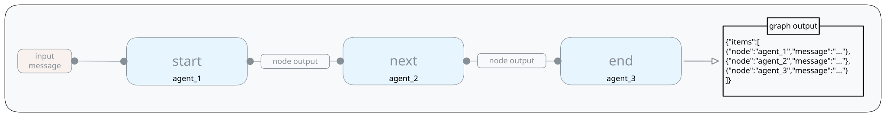
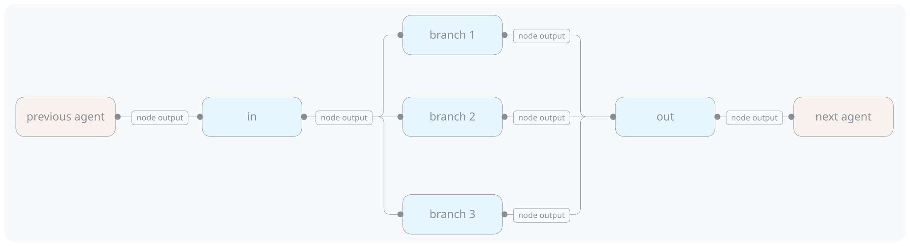
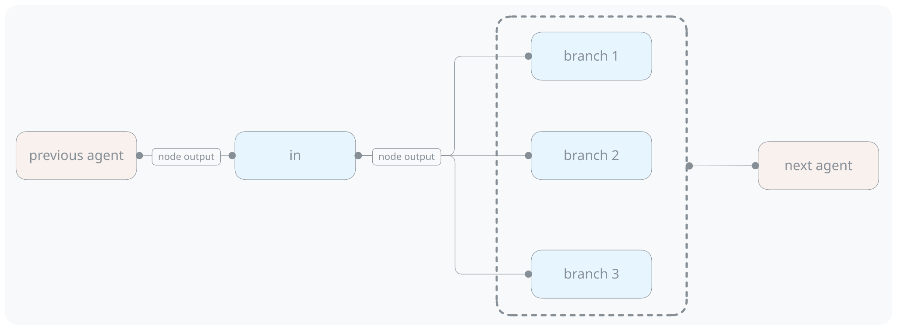
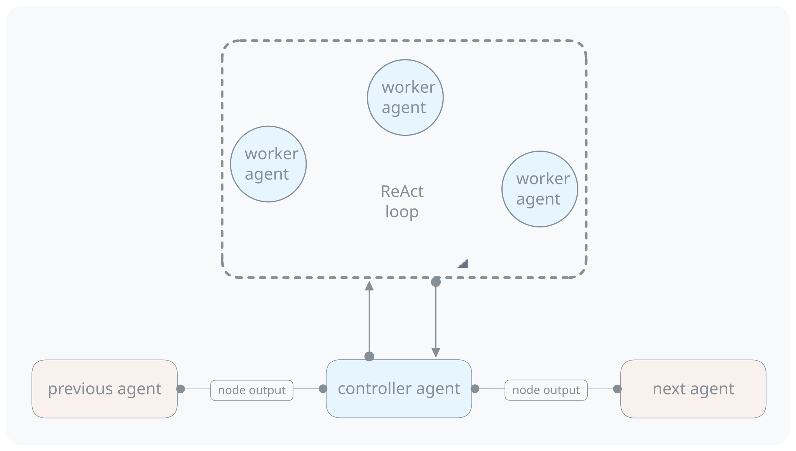
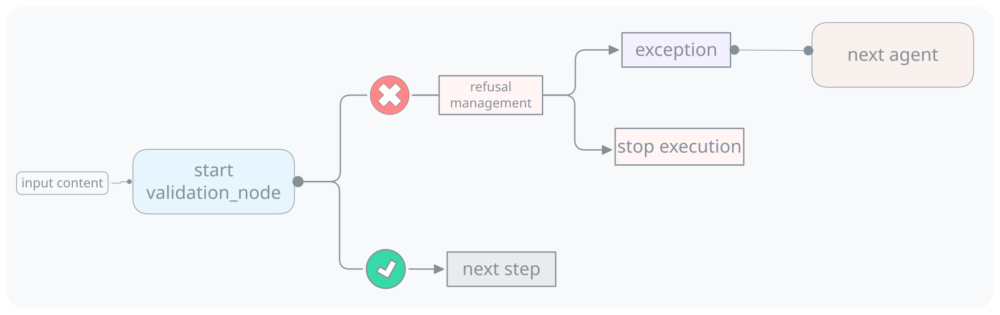
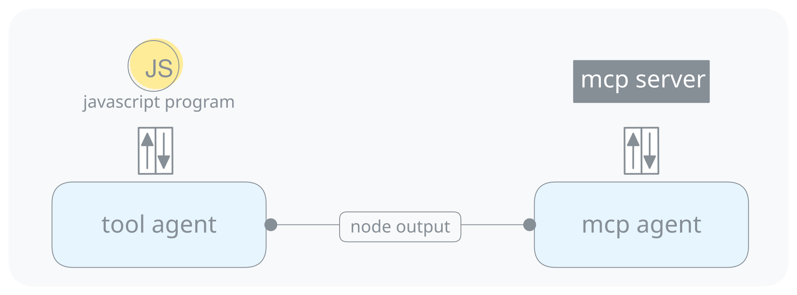
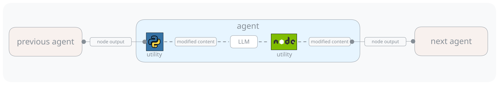
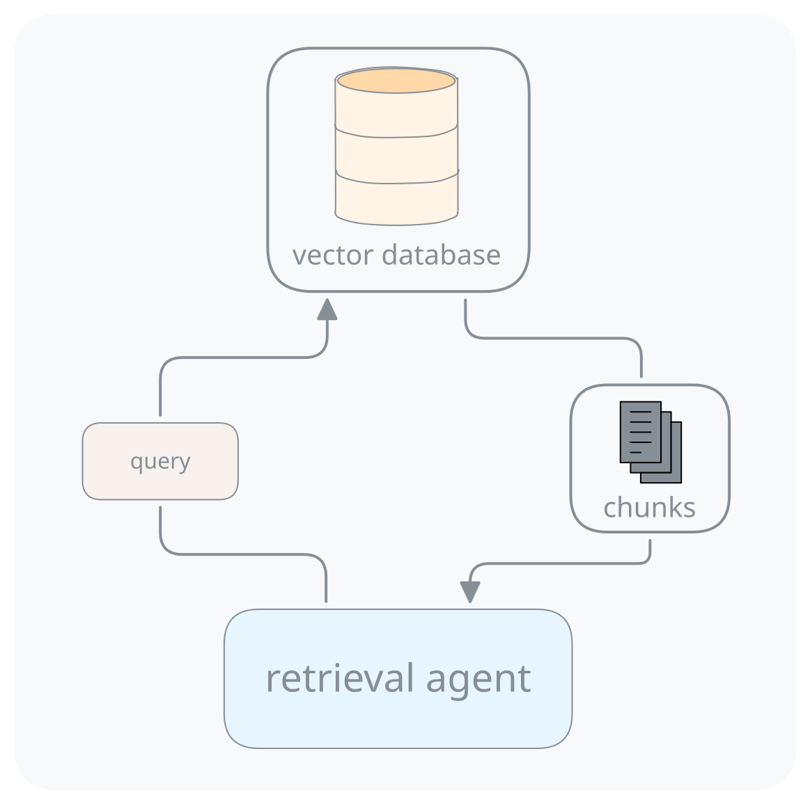
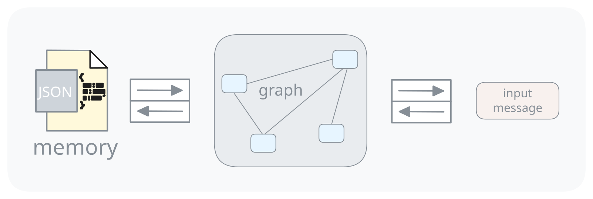
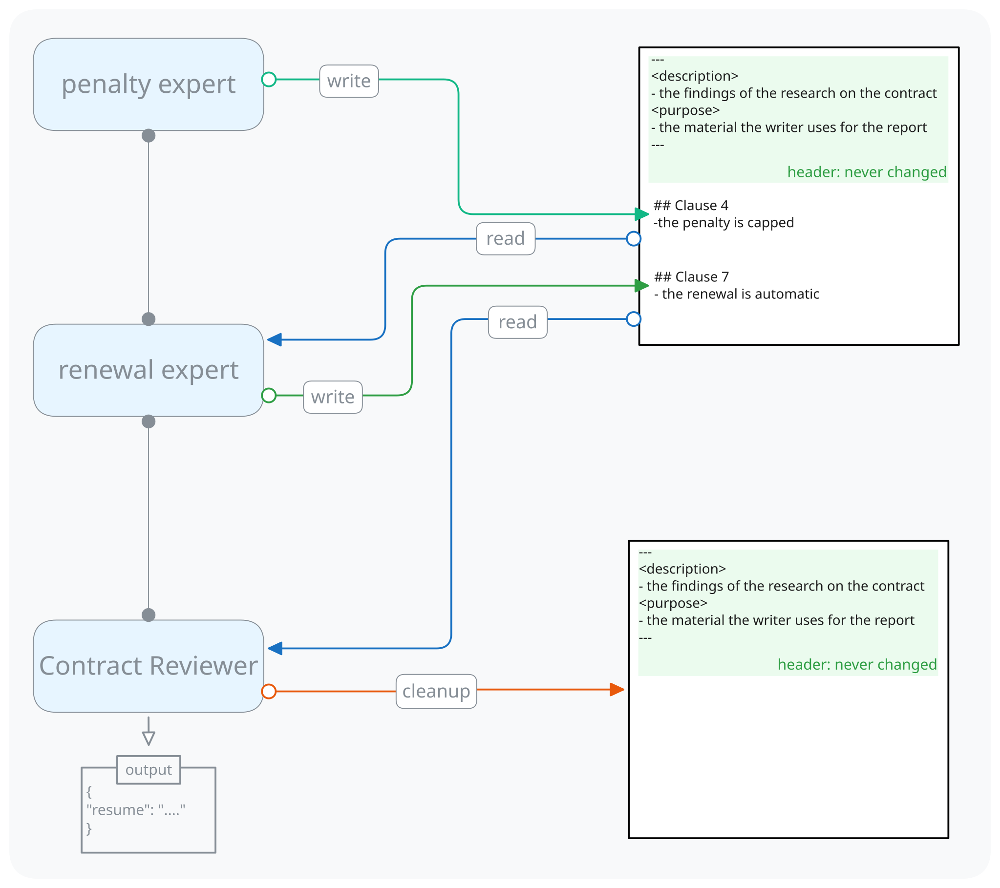

# Quick reference

Everything needed to write and run a graph, on one page, for people and for assistants. The other pages of `docs/`
say the same things at length; [the reference](graph.md), generated from the code, lists every key.

## Contents

[A whole graph](#a-whole-graph) · [The file](#the-file) · [Passport](#passport) ·
[Log, trace, display](#log-trace-display) · [Models](#models) · [Embeddings](#embeddings) · [Nodes](#nodes) ·
[Prompts](#prompts) · [Structured output](#structured-output) · [Edges](#edges) · [Tools](#tools) ·
[MCP servers](#mcp-servers) · [Skills](#skills) · [Utilities](#utilities) · [Vector databases](#vector-databases) ·
[Memory](#memory) · [Blackboards](#blackboards) · [Media](#media) · [Running a graph](#running-a-graph) ·
[Not supported yet](#not-supported-yet)

## A whole graph

A graph is one YAML file. This one, shortened from [`examples/02-sequence`](../examples/02-sequence/graph.yml),
translates the message of the user, then shortens the translation:

```yaml
graph_spec: "1.0"
passport:
  adl:
    adl_spec: "0.3.0"
    name: sequence
    description: Two nodes one after the other.
    version: "1.0.0"
    data_classification: { sensitivity: public }
    permissions: { network: { allowed_hosts: [localhost:11434] } }
observability: { level: warn }
verbose: { level: steps }
models:
  - id: local
    provider: ollama
    model: qwen3.5:4b
    host: http://localhost:11434
    input: [text]
    output: [text]
resources:
  prompts:
    - id: translate
      content:
        system: "Translate the text into Italian. Answer only with the translation."
        user: "{{user_message}}"
    - id: shorten
      content:
        system: "Shorten the text to at most ten words, in the same language."
        user: "{{agent_message}}"
graph:
  nodes:
    - id: translator
      model: { id: local, max_tokens: 300 }
      resources: { prompt: translate }
      message:
        input: { user_message: true }
        output: { assistant_message: true, node: true }
    - id: shortener
      model: { id: local, max_tokens: 300 }
      resources: { prompt: shorten }
      message:
        input: { agent_message: true }
        output: { assistant_message: true }
  edges:
    - start: translator
    - end: shortener
```

```
a-graph --check graph.yml           # only checks the file: nothing runs
a-graph graph.yml "the message"     # checks the file, then runs it
```

The result, on the standard output, has one item for each result a node sends to the final output, in the order they
were produced:

```json
{"items":[{"node":"translator","message":"...","media":[],"reasoning":[],"logprobs":[]}, ...]}
```

## The file

| Block | Required | What it holds |
|---|---|---|
| `graph_spec` | yes | the version of the format: `"1.0"` |
| `passport` | yes | the identity of the graph ([ADL](https://www.adl-spec.org/) 0.3.0) and the hosts it may reach |
| `observability` | yes | the log |
| `verbose` | yes | the live display |
| `trace` | no | the timeline of the run, sent to an OpenTelemetry collector |
| `models` | yes | the language models |
| `embeddings` | no | the models that turn a text into a vector |
| `utilities` | no | programs and services that change the data of a node |
| `resources` | no | `prompts`, `tools`, `mcp_servers`, `media`, `skills` |
| `external` | no | `vectordb`, `search`, `memory` |
| `blackboards` | no | Markdown texts shared by the nodes |
| `graph` | yes | `nodes` and `edges` |

- **Order.** The blocks may be written in any order.
- **Keys.** Only the keys of [the reference](graph.md) are accepted: a key not allowed where it is written is
  `unexpected_field`, a missing mandatory key `missing_field`, a value of the wrong kind `bad_value`.
- **Ids.** Models, embeddings, utilities, prompts, tools, MCP servers, media, skills, vector databases, search engines,
  memories, blackboards and nodes have an `id`. An id is unique in the whole file, whatever it names: a model and a
  node cannot both be `writer` (`duplicate_id`). Citing an id that is not declared, or that names something of
  another kind, is `unknown_ref`.
- **Secrets.** A secret is never written in the file, only the name of the environment variable that holds it:
  `api_key: { env: ANTHROPIC_API_KEY }`. A secret written as text, `"${ANTHROPIC_API_KEY}"` included, is `bad_value`:
  there is no substitution inside texts. A variable that is not set is `env_missing`: when the file is checked for the
  keys of the models and the headers of tools, utilities, the log, the trace and the urls of media and prompts; during
  the run, as `io`, for the key of a vector database and the `env` and `headers` of an MCP server.
- **Paths.** Every path of the file (prompt, media, skill, memory, blackboard file, log file) is relative to the folder
  the command is run from, not to the folder of the graph.
- **Check.** The whole file is checked before anything runs, and all its errors are reported together.

## Passport

```yaml
passport:
  adl:
    adl_spec: "0.3.0"
    name: contract-brief                    # the service name of the trace
    description: Summarizes a contract.
    version: "1.0.0"                        # three numbers
    data_classification:
      sensitivity: internal                 # public, internal, confidential or restricted
      categories: [pii]                     # optional
    lifecycle:                              # optional; the program does not act on it
      status: active                        # draft, active, deprecated or retired
      sunset_date: "2027-01-01T00:00:00Z"   # optional, RFC 3339 with a time zone
    permissions:
      network:
        allowed_hosts: [api.anthropic.com, localhost:11434]
```

The key names are those of ADL.

**`data_classification`** decides whether the contents (prompts, answers, reasoning, results of tools, details of
errors) are written in the log, the trace and the display: only with `sensitivity: public` and no `categories`.
`categories` is a list of `pii`, `phi`, `financial`, `credentials`, `intellectual_property` and `regulatory`; any one
hides the contents. Hidden contents are marked `content_redacted`.

**`permissions.network.allowed_hosts`** lists the hosts the graph may reach. Without `permissions`, no host is
allowed. Every destination written in the file is checked before anything runs (`network_not_allowed`):

- the host of every model and embedding (the host of its `host`, when it has one), and for a `bedrock` model with a
  `batch` also the Bedrock control API and the S3 buckets;
- the `url` of utilities, tools and MCP servers with `transport: http`;
- the `url` of prompts and media read from the network, of vector databases and of search engines;
- `observability.output.url` and `trace.endpoint`.

How an entry is written and compared:

- A host name, not a URL: `api.anthropic.com`, not `https://api.anthropic.com/v1`. An entry that is a URL or carries a
  path is `bad_value`. Hosts are compared without regard to case, and an entry is read as the host of a URL is read:
  `127.1` counts as `127.0.0.1`, `[0:0:0:0:0:0:0:1]` as `[::1]`.
- `host` allows every port; `host:port` (`localhost:11434`, `[::1]:8080`) allows that port only. A port that is not a
  number from 1 to 65535 is `bad_value`.
- The port of a destination is the one written in its URL, or 80 for `http` and 443 for `https`. The host of a provider
  (`api.anthropic.com`, the Bedrock and S3 hosts) is reached on 443. A URL whose scheme has no known port is allowed
  only by an entry without a port.
- A local server is a host too: a model at `http://localhost:11434` needs `localhost` or `localhost:11434`.
- Redirects are not followed. The traffic the cloud SDKs make for `credentials: ambient` (metadata servers, token
  endpoints) is not checked. The standard output, files and the display are not network.

## Log, trace, display

```yaml
observability:
  level: info                     # debug, info, warn or error
  output: stderr                  # the default; or stdout, { file: <path> }, { url: <endpoint>, headers: ... }
trace:                            # optional: without it there is no trace
  endpoint: http://localhost:4318/v1/traces
  headers: { Authorization: { env: OTEL_TOKEN } }   # optional
  capture_content: false          # the default
  max_content_bytes: 4096         # the default, at least 1
verbose:
  level: steps                    # off, steps or detail
```

The three read the same events; contents appear in them only as the passport allows.

- **`observability`, the log**, for machines: one JSON object per line, with `ts`, `level`, `code` and, when there is
  one, `node`, plus `trace_id` and `span_id`. `level` is the lowest level written: `info` writes the run, the nodes and
  the groups; `debug` also the calls (models, tools, utilities, readings of vector databases, memories, media and
  prompts); `warn` and `error` only the problems. `output`:
  - `stderr` (the default): with the errors, so that the standard output holds only the result;
  - `stdout`: mixed with the result;
  - `{ file: <path> }`: added to the file, created if it does not exist;
  - `{ url: <endpoint>, headers: { <name>: { env: <VARIABLE> } } }`: POSTs of `application/x-ndjson`, at most 100
    events each.

  A log that cannot be written never stops the run.
- **`trace`, the timeline**: at the end of the run, also when it fails, one POST in OTLP over HTTP with JSON to
  `endpoint`, exactly as written. One span for the run, every group, every node, every model call, tool call, MCP call,
  skill call and checked answer, and for the utilities and readings around a node. The contents are left out unless
  `capture_content: true`, and even then only as the passport allows; `max_content_bytes` cuts each content. The
  service name is `passport.adl.name`.
- **`verbose`, the display**, for a person, on the standard error while the run goes: `off` nothing; `steps` the run,
  the nodes and the groups as they start and end, with durations and tokens, and the errors and warnings; `detail`
  also the model calls, the tool calls, the checked answers, the utilities, the readings and the downloads, and the
  contents. For a standard error of JSON only, set `verbose: { level: off }` or send the log to a file or a url.

The log sent to a url and the trace are POSTed with a timeout of 10 seconds each; a network error, a 5xx or a 429 is
tried again up to 3 times; what cannot be delivered is dropped, with a notice on the standard error. The events of the
log are listed in [observability](observability.md#the-events).

## Models

```yaml
models:
  - id: smart
    provider: anthropic
    model: claude-sonnet-5-5               # the name at the provider
    api_key: { env: ANTHROPIC_API_KEY }
    input: [text, image]                   # text, image, audio, video
    output: [text]
  - id: local
    provider: ollama
    model: qwen3.5:4b
    host: http://localhost:11434
    input: [text]
    output: [text]
```

Every model has `provider`, `id`, `model`, `input` and `output`; `provider` decides the other keys. The program does
not check the nodes against `input` and `output`: what a node sends or asks is checked against what the provider can
do.

| `provider` | Its keys | Host to allow |
|---|---|---|
| `anthropic` | `api_key`; optional `workspace_id`, `host` | `api.anthropic.com`, or the host of `host` |
| `openai` | `api_key`; optional `host` | `api.openai.com`, or the host of `host` |
| `gemini` | `api_key`; optional `host` | `generativelanguage.googleapis.com`, or the host of `host` |
| `mistral` | `api_key`; optional `host` | `api.mistral.ai`, or the host of `host` |
| `bedrock` | `region`; `credentials`: `ambient` or `{ access_key, secret_key, session_token }`; optional `batch: { input_s3_uri, output_s3_uri, role_arn }` | `bedrock-runtime.<region>.amazonaws.com` |
| `vertex_ai` | `publisher` (`anthropic` or `google`), `project`, `location` (`global`, `us`, `eu` or a region), `credentials: ambient`; optional `batch: { input_uri, output_uri_prefix }` | `aiplatform.googleapis.com` (`global`), `aiplatform.<us\|eu>.rep.googleapis.com`, `<location>-aiplatform.googleapis.com` |
| `azure_foundry` | `publisher` (`anthropic` or `openai`), `resource`, `credentials`: `ambient` or `{ api_key }`; optional `batch: { deployment }` | `<resource>.services.ai.azure.com` (`anthropic`), `<resource>.openai.azure.com` (`openai`) |
| `ollama` | `host` | the host of `host` |
| `custom` | `host`: a server of your own, called with `POST <host>/api/chat` in the format of the Ollama API | the host of `host` |

- **Publishers.** On `vertex_ai` and `azure_foundry`, with publisher `anthropic` the model works as `anthropic` and
  produces text only; with `google` as `gemini`, with `openai` as `openai`. On `azure_foundry`, `model` is the name of
  the deployment created in the Foundry portal.
- **Gateway.** `host` on `anthropic`, `openai`, `gemini` and `mistral` sends every call (the batches and the produced
  media too) to another server, which must speak the same API: `<host>/v1/messages`, `<host>/responses` (the Responses
  API, not Chat Completions), `<host>/v1beta/interactions`, `<host>/v1/chat/completions`. The host of `host` must be in
  `allowed_hosts`, and the key goes there.
- **Credentials.** `api_key` is read when the file is checked. `ambient` is resolved by the SDK of the cloud at the
  first call: on `bedrock` the default chain of the AWS SDK, on `vertex_ai` the Google Application Default Credentials,
  on `azure_foundry` the managed identity, then the Azure CLI, then the Azure Developer CLI. `ollama` and `custom` take
  none.
- **Time.** A call that does not end within 10 minutes is abandoned and fails like a network error.
- **Errors.** A provider that answers with an error fails the node (`model_failed`); the message gives the status and
  the code of the provider, its text is the `detail`, written only as the passport allows.

What each provider can do, checked when the file is checked (`not_supported`):

| `provider` | Media in | Media out | Batch | Logprobs | Schema | Refusal |
|---|---|---|---|---|---|---|
| `anthropic` | text, images (jpeg, png, gif, webp) | none | yes | no | yes | yes |
| `openai` | text, images | one image or one audio per call | yes | yes | yes, not with a produced media | yes |
| `gemini` | text, images | one image or one audio per call | no | no | yes, not with a produced media | no |
| `mistral` | text, images | one audio per call (speech) | yes | yes | yes, not with a produced media | no |
| `bedrock` | text, images (png, jpeg, gif, webp) | none | yes, without an output `schema` | no | yes, not in a batch | yes |
| `vertex_ai`, publisher `anthropic` | as `anthropic` | none | no | no | yes | yes |
| `vertex_ai`, publisher `google` | as `gemini` | as `gemini` | no | no | as `gemini` | no |
| `azure_foundry`, publisher `anthropic` | as `anthropic` | none | no | no | yes | yes |
| `azure_foundry`, publisher `openai` | as `openai` | as `openai` | yes | as `openai` | as `openai` | yes |
| `ollama`, `custom` | text, images | none | no | yes | yes (the cloud models of Ollama ignore it: use `schema_prompt`; on `custom` it depends on the server) | no |

Every provider has tools. Audio and video cannot be read by any model yet. On `bedrock`, and with publisher
`anthropic`, an `output` with anything but `text` is `output_not_text`. A refusal, on the providers that tell one,
stops a node with a schema (`model_refused`); on the others it is an ordinary text.

**On a node**, `model` is:

```yaml
model:
  id: smart
  max_tokens: 2000      # mandatory with anthropic and with publisher anthropic; otherwise the provider decides
  reasoning: medium     # off, minimal, low, medium, high or max; without it nothing is sent
  temperature: 0        # given to the provider as written
  top_p: 1              # given to the provider as written
```

A `reasoning` level the provider does not have becomes the nearest one: `minimal` becomes `low` on `anthropic` and
`bedrock`, `max` becomes `high` on `gemini` and `ollama`. `off` is an error on `gemini` and with publisher `google`.
Which models can reason is not known in advance: a model that does not accept the level answers with an error during
the run.

**Batch.** A `batch` group (see [groups](#groups-fan-out-and-fan-in)) sends its branches as batch jobs:

- `anthropic`, `openai` and `mistral` need nothing more;
- `bedrock` needs `batch` on the model, two `s3://` folders (`bad_value` otherwise) and an IAM role, and the Bedrock
  control API (`bedrock.<region>.amazonaws.com`) and the S3 bucket of each folder in `allowed_hosts`;
- `azure_foundry` with publisher `openai` may name its Global-Batch `deployment`;
- a `batch` block is accepted on `vertex_ai` only with publisher `google` (not available yet) and on `azure_foundry`
  only with publisher `openai` (`batch_not_allowed`);
- a job the run lets go of (the run stopped, a branch beside it failed) is cancelled at the provider.

## Embeddings

```yaml
embeddings:
  - id: embedder
    provider: ollama          # the only provider
    model: embeddinggemma
    host: http://localhost:11434
```

An embedding model turns a text into a vector, with `POST <host>/api/embed`. It takes no credentials; its host must be
in `allowed_hosts`. A vector database cites one with `embedding`, a memory with `chat.embedding`. A wrong answer of the
server, or an error, fails the node (`model_failed`).

## Nodes

```yaml
- id: analyst
  model: { id: smart, max_tokens: 2000 }
  resources:
    prompt: analyze
    tools: [get_weather]
    mcp_servers: [files]
    skills: [pdf]
    max_rounds: 20                       # the default
  message:
    input: { user_message: true, agent_message: false, utility: redact }
    output: { assistant_message: true, node: true, reasoning: false, utility: redact }
```

A node is a model plus what it uses, where its input comes from and where its output goes. No node knows its
neighbours: the order is decided by the edges alone. A node has `id` and `model`, and optionally `resources`,
`message`, `media`, `external` and `blackboard`.

Every source and every destination is a separate `true` or `false`, `false` by default; several can be `true`, and all
can be `false`, for a node useful only for what it does along the way (writing a blackboard or a memory, calling
tools).

| Key | `true` means |
|---|---|
| `message.input.user_message` | the node takes the message of the user, the one given to the command |
| `message.input.agent_message` | the node takes what the node before sends on |
| `message.output.assistant_message` | the answer goes to the final output |
| `message.output.node` | the answer goes to the node after, as its `agent_message` |
| `message.output.reasoning` | the reasoning goes to the final output, even with `assistant_message: false`; never to another node |

- A node that takes a message that does not arrive (`agent_message` after a node that sends nothing on) fails when it
  runs.
- `message.output.logprobs: <n>`, from 0 to 20, puts in the final output the log probability of every token of the
  answer, with the `n` most likely alternatives of each token, even with `assistant_message: false`, never to another
  node: one list for each call to the model, the last being the final answer. Only on `openai`, `mistral`, `ollama`,
  `custom` and `azure_foundry` with publisher `openai`, and not on a node that produces a media; elsewhere
  `not_supported`. On `ollama` and `custom` a model that reasons gives the tokens of its reasoning too, before those of
  the answer: set `reasoning: off` for the answer alone. A model that ignores the request stops the run
  (`model_failed`).

How a node runs:

1. The messages it takes go through `message.input.utility`. The changed text is used from here on: in the prompt, in
   the queries and in what the memories save. A message the node does not take is not changed.
2. It reads what it declares: the vector databases (`{{chunks}}`), the memories (history and summary), the blackboard
   if it reads it, the media of `media.input`.
3. The placeholders of the prompt are filled and the model is called.
4. If the model asks for tools, MCP tools or skills, they are called and the model is called again with their
   results, until it answers without asking: at most `resources.max_rounds` rounds (20 by default, at least 1; one more
   is `tool_limit`). Every round counts, whatever it asks for.
5. The answer goes through `message.output.utility` once, and the same text goes to every destination: the final
   output, the next node, the blackboard if the node writes it, the memories as their `write` says.

## Prompts

```yaml
resources:
  prompts:
    - id: analyze
      content:
        system: "You are an analyst specialized in contracts."
        user: "Context: {{findings}}\nQuestion: {{user_message}}"
    - id: review
      source: { path: ./prompts/review.yml }   # a .yml file with the same content: { system, user }
    - id: plan
      source:
        url: https://prompts.example.com/plan.yml
        headers: { Authorization: { env: PROMPTS_TOKEN } }
```

A prompt has exactly one of `content` and `source` (`exactly_one`); a node uses it with `resources.prompt`.

- `source.path` is a `.yml` file with `content: { system, user }`, not Markdown, read when the file is checked.
- `source.url` answers the same text and is downloaded when the run starts, before the first node; its placeholders
  are checked then, and the run stops at the first broken one. A text that is not `content: { system, user }` is
  `bad_value`; one with a YAML alias, a tag or more than 100000 YAML events is `not_supported`.

A placeholder is `{{name}}`, replaced by its value in `system` and in `user`: a plain substitution, with no conditions
or loops. A name is made of letters, digits, `_` and `-`, spaces inside the braces ignored; a `{{` not closed or an
invalid name is `placeholder_malformed`.

| Placeholder | Its value | Available when the node has |
|---|---|---|
| `{{user_message}}` | the message of the user | `message.input.user_message: true` |
| `{{agent_message}}` | what the node before sent on | `message.input.agent_message: true` |
| `{{input_message}}` | the message, whichever its origin | exactly one of the two above |
| `{{chunks}}` | the text found in the vector databases | `external.vectordb` |
| `` | the summary of the memory, empty until there is one | that memory, with `synt` |
| `` | the text of the blackboard | `blackboard` with `read: true` |
| `` | what the search engine finds (search cannot run yet) | that id in `external.search` |

The prompt and the node must agree in both directions, checked with the file:

- every placeholder must be available on the node (`placeholder_unbound`);
- everything the node declares must be used: `{{chunks}}` with a vector database, each memory with `synt`, a
  blackboard it reads, each search (`placeholder_unused`);
- the message must be used: with both messages, both `{{user_message}}` and `{{agent_message}}`; with one, it or
  `{{input_message}}` (`placeholder_unused`);
- `{{input_message}}` cannot be mixed with the other two (`placeholder_input_mixed`);
- `chunks`, `user_message`, `agent_message` and `input_message` are reserved: nothing on the node can have one as its
  id, and the same id cannot appear twice on a node (`duplicate_id`).

A node without a prompt sends its message as the user text, with no system text; it needs exactly one of the two
messages (`prompt_required`), and it cannot read a vector database. The prompt of a memory summary has its own
placeholders, `{{synt}}` and `{{chat}}` (see [memory](#memory)).

## Structured output

```yaml
message:
  output:
    node: true
    schema:                     # or schema_prompt, never both (unexpected_field)
      type: object
      properties: { verdict: { type: string } }
      required: [verdict]
    max_attempts: 3             # with schema_prompt only; the default, at least 1
```

- **`schema`**: a JSON Schema, written as YAML or as JSON in a text; the API of the provider enforces it. The schema
  reaches the model with its keys in the order written; `ollama` and `openai` make the model write the fields in that
  order.
- **`schema_prompt`**: for a model whose API does not enforce a schema (the cloud models of Ollama, for one). The
  provider gets no schema; a-graph adds at the end of the system prompt a request to answer with one JSON value and the
  schema. An answer that is not one JSON value is sent back with a request to answer again, up to `max_attempts`
  calls, the first included; the last one failing too is `attempt_limit`. Not on the nodes of a `batch`
  (`batch_schema_prompt`).
- A schema that is not a valid JSON Schema is `bad_value`.
- The answer is the whole text, or the whole content of the one code fence (` ``` ` or ` ```json `) it is made of.
  The run stops when it is not one JSON value or does not match the schema (`schema_mismatch`), when the model refuses
  (`model_refused`, on the providers that tell a refusal), and when the answer was cut at `max_tokens` or at the end
  of the context window (`model_failed`).
- What goes on, to the final output, the next node and the memories, is only the JSON. Output utilities receive it as
  a text and give back a text.
- A node with tools may have a schema: only the final answer is checked.
- With `openai`, `gemini` and `mistral` a node cannot ask a schema and a produced media together (`not_supported`).

## Edges

`graph.edges` is a list read in order, like a program. Every entry is a map with one key.

| Entry | Meaning |
|---|---|
| `start: <node>` | the first entry, and the only one (`edge_start`) |
| `next: <node>` | a node after the entry before it |
| `end: <node>` | the last entry, and the only one (`edge_end`) |
| `linear`, `parallel`, `concurrent`, `batch` | a group |
| `react` | a controller and its workers |

- A graph of one node is its `start` alone: the node runs once and its output is the result.
- A graph whose first entry is a group or a `react` may leave out `start`: that entry takes the message of the user,
  and no `agent_message`. A graph whose last entry is a group or a `react` may leave out `end`: the result is what the
  nodes send to the final output. Every other graph needs both.
- A node may appear more than once: each appearance is a run of it. `start: a` and `end: a` run `a` twice.
- What a node sends on (`message.output.node`, and the media with `node: true`) is what the next entry receives as
  its `agent_message` and its media.
- A node is a controller or a worker because it appears as one in a `react`, and a plain step anywhere else.

### Pipeline



```yaml
edges:
  - start: translator
  - next: reviewer
  - end: shortener
```

### Groups: fan-out and fan-in





```yaml
- parallel:
    - limit: 2          # optional here; mandatory in concurrent, not allowed in linear
    - in: framing       # mandatory: runs first; what it sends on is the input of every branch
    - fan:              # mandatory, at least one branch
        - next: advantages
        - next: disadvantages
        - linear:       # a branch can be a whole group or react: groups nest
            - in: risks
            - fan:
                - next: legal   # no out here: legal must not send its output on
    - out: balance      # optional: receives the answers of all the branches, packed as one
```

`limit`, `in`, `fan`, `out`: each written once, in this order (`block_shape`, `exactly_one`).

| Group | How the branches run | `limit` |
|---|---|---|
| `linear` | one after the other | not allowed |
| `parallel` | all together, each as a task of its own | optional: at most `limit` at a time |
| `concurrent` | all together, at most `limit` at a time | mandatory |
| `batch` | as batch jobs of the provider: one job, or jobs of `limit` requests one after the other | optional |

- **Packing.** `out` receives the answers of the branches as its `agent_message`, in the order of the `fan`: texts
  joined one after the other, each preceded by `---\nfrom agent <id>\n---`; answers with a `schema` as one JSON list of
  `{ "from_node": "<id>", "content": <the answer> }`. Texts and structured answers together fail the run. The media of
  all the branches reach `out` together.
- **Without `out`** the group sends nothing on, and the next entry starts when the branches are done; it is allowed
  only if no node of the group sends its output on (`group_out_required`).
- **Final output.** What the nodes of a group send to the final output goes there in the order of the `fan`.
- **Failures.** In `parallel` and `concurrent`, the first branch that fails ends the run, and the others are stopped.
- **`batch`.** The branches are plain nodes, all with the same model: a group or a `react` among them is an error.
  They cannot have tools, MCP servers or skills (`batch_tools`), a `schema_prompt` (`batch_schema_prompt`) or a
  produced media. The `in` and `out` do not run in the batch and may have them. See [models](#models) for what each
  provider needs.

### React: controller and workers



```yaml
- react:
    controller: planner
    max_iterations: 10        # the most calls to workers; one more is react_limit
    structured_output: api    # api, or prompt with max_attempts (default 3)
    components:
      - worker: researcher
      - worker: writer
      - parallel:             # a whole group, called by the id of its in node
          - in: collect
          - fan:
              - next: source_a
              - next: source_b
          - out: merge
```

At every turn the controller answers a fixed structure, which the program asks of its model:

- `done`: `true` with the final answer, `false` to call a worker;
- `next_worker`: the worker to call; `input`: what it receives, as its `agent_message`;
- `answer`: the final answer; `reasoning`: why it chose this step.

The worker runs, and what it sends on comes back to the controller as an observation for the next turn. When the
controller is done, its `answer` is the output of the `react`, delivered as the output of the controller. The program
gives the controller only the ids of the workers: what each one does must be written in the prompt of the controller.

- `structured_output` (mandatory): `api`, enforced by the provider as `schema`; `prompt`, by a-graph as
  `schema_prompt`, with `max_attempts` counted at every turn.
- The controller has no tools, MCP servers, skills, blackboard, output `schema` or `schema_prompt`: give those to a
  worker.
- Two workers with the same id are `duplicate_id`. A `react` cannot be a worker of another `react`, nor stand in a
  group among its workers (`react_nested`).

### Validation node: the judge



```yaml
- id: check_answer
  validation-node:
    model: { id: smart, max_tokens: 1000 }
    resources: { prompt: criterion }     # mandatory: the criterion of the judgment
    message: { input: { agent_message: true } }
    structured_output: prompt            # api or prompt
    max_attempts: 3                      # with prompt only; the default
    on_error: stop                       # stop or node
```

A validation node reads and judges, and produces nothing. Its answer always has the shape
`{ "validation": true | false, "reasons": "...", "log": "..." }`; the key `response` is accepted and not used.

- Approved: the message it received from the node before goes on unchanged, whatever its `message.input` reads; as
  `start` it received none, and none goes on. The media do not pass.
- Refused, `on_error: stop`: the run ends, `end` is not reached, and the final output gets one more item from the
  judge, with `reasons: ...` and `log: ...`.
- Refused, `on_error: node`: the run goes on, and the next node receives the problem as its `agent_message`; a node
  must follow (`validation_no_next`).
- It stands only in the main flow (`start`, `next`, `end`), never in a group or a `react` (`validation_in_group`).
- It has `model`, `resources.prompt`, `message.input`, `media.input`, `external` (vector databases, search, memories
  read whole, both roles, without writing) and `blackboard` (read without writing). No tools, MCP servers, skills,
  `output`, `write` or `cleanup`.

## Tools



```yaml
resources:
  tools:
    - id: get_weather               # the name the model calls it by
      description: Returns the current weather for a city   # told to the model
      transport: stdio              # the program is started for each call
      command: python3
      args: [tools/weather.py]
      max_iter: 10                  # calls in one run of a node, failures included; one more is tool_limit
      timeout: 30                   # seconds; then the program is killed and the model is told
      parameters:                   # the JSON Schema of the arguments, an object
        type: object
        properties: { city: { type: string, description: City name } }
        required: [city]
    - id: lookup
      description: Looks up a customer by id
      transport: http               # the arguments are POSTed to url
      url: https://tools.example.com/lookup
      headers: { Authorization: { env: TOOLS_TOKEN } }
      max_iter: 5
      timeout: 30
      parameters: { type: object, properties: { id: { type: string } }, required: [id] }
```

A tool is a program or a service the model may call; the program makes the call. A node lists its tools in
`resources.tools`. The model knows a tool by its `id`, its `description` and its `parameters`, which must be a valid
JSON Schema (`bad_value`).

**The contract.** A tool receives one JSON object, the arguments, and answers one JSON value, the result.

- `stdio`: `command` is started with `args` for each call; the arguments arrive on its standard input, the result is
  what it writes on its standard output. An exit code other than 0 is a failure, and the model gets the standard error.
- `http`: the arguments are the body of a `POST` to `url` with `headers`; the result is the body of the answer. A
  status other than 2xx is a failure, and the model gets the status and the body.
- An answer that is not JSON is a failure too.

**When a call goes wrong**, the model is told, and may try again or answer otherwise: arguments that do not match
`parameters` (the tool is not called; the call counts in `max_iter`), a failure, a timeout, a tool the node does not
have. A program that cannot start stops the run. An answer cut at `max_tokens` that asks for tools calls none and stops
the run (`model_failed`); a refused answer that asks for tools calls none.

**The loop.** The model is called with the tools; the calls asked in one answer run together; their results go back to
the model; the answer that asks for no tool is the answer of the node. `max_iter` counts again for each node and each
appearance of the node in the edges.

## MCP servers

```yaml
resources:
  mcp_servers:
    - id: files
      transport: stdio              # the program is started when the run starts
      command: python3
      args: [mcp_servers/files.py]
      env: { ROOT: { env: FILES_ROOT } }    # its variables, read from the environment
      max_iter: 10                  # calls to any of its tools, in one run of a node; one more is tool_limit
      timeout: 30                   # seconds of a call; then the model is told
    - id: search
      transport: http               # Streamable HTTP
      url: https://mcp.example.com/mcp
      headers: { Authorization: { env: MCP_TOKEN } }
      max_iter: 10
      timeout: 30
```

A server of the [Model Context Protocol](https://modelcontextprotocol.io); a node lists it in `resources.mcp_servers`.
Only its **tools** are used, never its resources or prompts.

- The servers some node uses are connected once, when the run starts, and asked for their tools; `--check` never
  connects them. A server that cannot be reached or does not give its tools, or answers more than 16 MiB over HTTP,
  stops the run before the first node.
- Two tools with the same name on one node (from `tools`, from different servers, or a reserved name of the skills)
  stop the run before the first node (`duplicate_id`).
- The arguments of a call are checked against the input schema the server gives; a schema that is not valid is not
  enforced, with the warning `tool_schema_ignored`.
- The result is the structured content of the answer, or else its text blocks one per line. An answer the server marks
  as an error reaches the model as an error; a timeout is a failure the model is told about.
- A server that goes away during a call is connected again once, and the call repeated; if that fails, the model is
  told that the server is not reachable.

## Skills

```yaml
resources:
  skills:
    - id: pdf
      path: ./skills/pdf-processing # the folder, with its SKILL.md
      run_scripts: true             # the default
      max_iter: 20                  # reads of files and runs of scripts together; the default
      timeout: 30                   # seconds of a script; the default
      max_files: 200                # files listed at activation; the default
      max_file_bytes: 100000        # largest file read, and output of a script kept; the default
      max_depth: 6                  # levels of sub-folders listed; the default
```

A skill is a folder in the [Agent Skills](https://agentskills.io/specification) format: instructions for a task, with
the files and scripts they need; a node lists it in `resources.skills`. Every limit is at least 1. `SKILL.md` starts
with a frontmatter, read when the file is checked:

```markdown
---
name: pdf-processing
description: Extracts the text and the tables of PDF files. Use it when the user gives a PDF.
---
# Processing PDFs

1. Run `scripts/extract.py <file>` to get the text.
2. Read `reference.md` for the tables.
```

- `name` (mandatory): at most 64 characters, lowercase letters, digits and hyphens, not at the start or the end and
  not two in a row; it must be the name of the folder. `description` (mandatory): at most 1024 characters.
  `compatibility` (1 to 500 characters), `license`, `metadata` and `allowed-tools` are optional; `allowed-tools` is
  kept and not enforced. Any other field is ignored, with a warning. The name and description are never written in the
  graph file.

How the model uses a skill:

1. The system text of the node ends with how to use the skills and a catalog of their names and descriptions.
2. `activate_skill` (parameter: the name) gives the instructions of `SKILL.md`, without the frontmatter, inside
   `<skill_content name="...">`, and lists the other files of the folder with paths relative to it: at most
   `max_files`, at most `max_depth` levels down, hidden files and links leading out left out. Files are listed, not
   read. A skill is given once in a run of the node: a second activation is told that it is already loaded.
3. `read_skill_file` (`skill`, `path`) reads a text file inside the folder, of at most `max_file_bytes`; an absolute
   path, a `..`, a link leading out, a missing, binary or too large file are errors the model reads.
4. `run_skill_script` (`skill`, `path` inside `scripts/`, `args`), only with `run_scripts: true`, runs a script: without
   a shell, so nothing in its arguments is expanded, in the folder of the skill, with no standard input and only `PATH`
   in its environment (no keys). It needs the permission to execute, and a `#!` line if it is a script. The result is
   its standard output, cut at `max_file_bytes`; an exit code other than 0, a missing permission or a timeout reach the
   model as errors.

`max_iter` counts `read_skill_file` and `run_skill_script` together, not the activation; one more is `tool_limit`. The
three tool names are reserved: a node with skills cannot have a tool with one of them, nor two skills with the same
name (`duplicate_id`).

## Utilities



```yaml
utilities:
  - id: redact
    transport: stdio              # the program is started for each call
    command: python3
    args: [utilities/redact.py]
    timeout: 60                   # seconds, at least 1; then the run fails
  - id: to_markdown
    transport: http               # a service already running, never started or stopped by a-graph
    url: http://localhost:9000/convert
    headers: { Authorization: { env: CONVERT_TOKEN } }
    timeout: 60
```

A utility is a program or a service the **program** calls on the data of a node, before or after the model: to convert
a PDF into Markdown, to hide personal data, to add a mark. The model does not know it exists. A container that runs
once is a program too: `command: docker`, `args: [run, --rm, -i, <image>]`.

**The contract.** One JSON object in, one out: on the standard input and output (`stdio`), or as the body of a `POST`
and of its answer (`http`).

- It receives a text, `{ "text": "..." }`, or a file: `{ "path": "docs/a.pdf", "mime_type": "application/pdf" }` for a
  media from the resources with `source: { path }`, given to a program; `{ "data": "<base64>", "mime_type": "..." }`
  for every other file (any file for a service, a media in `base64` or from a `url`, a file made by a model, a node or
  a utility). a-graph writes no file of its own for a utility.
- `mime_type` comes from the extension of a file on disk (pdf, docx, xlsx, pptx, html, md, txt, csv, json, png, jpg,
  webp, gif, mp3, wav, mp4), from the `mime_type` the graph gives, or from what made the file; it is left out when
  nothing says it.
- It answers a text, `{ "text": "..." }`, or a file, `{ "mime_type": "...", "data": "<base64>" }`.
- A utility that fails stops the run, with its exit status or the status of its answer; what it wrote on its standard
  error or in its body is the `detail`, shown only as the passport allows. An answer with neither `text` nor
  `mime_type` with `data`, a timeout, or a file in memory that is not valid base64 is `utility_failed`.

**Where a node uses them.** `utility: <id>` or a list of ids, run in order, each getting what the one before answered:

| Place | What goes through | What they must give back |
|---|---|---|
| `message.input.utility` | the messages the node takes | a text |
| `message.output.utility` | the answer, once, before every destination | a text |
| `media.input[].utility` | a media the node reads | a text or an image |
| `media.output[].utility` | the file the model made, or the text of the node (`from: message`) | a file |
| `external.vectordb[].utility.query` | the query, before it becomes a vector | a text |
| `external.vectordb[].utility.chunks` | each chunk found, before the prompt | a text |
| `external.memory[].read.utility` | each message read back, and the summary | a text |
| `external.memory[].write.utility` | what is saved, after `message.output.utility` | a text |
| `blackboard.write.utility` | the text written, after `message.output.utility` | a text |

## Vector databases



```yaml
external:
  vectordb:
    - id: docs
      provider: qdrant              # or chromadb
      url: http://localhost:6333    # mandatory
      api_key: { env: QDRANT_KEY }  # optional; read when searched, sent as api-key
      collection: docs              # mandatory
      embedding: embedder
      text_field: text              # mandatory with qdrant, not allowed with chromadb
      top_k: 5                      # the default
      timeout: 60                   # seconds; the default, at least 1
    - id: notes
      provider: chromadb            # api_key sent as x-chroma-token
      url: http://localhost:8000
      collection: notes
      embedding: embedder
      tenant: default_tenant        # chromadb only; the default
      database: default_database    # chromadb only; the default
graph:
  nodes:
    - id: analyst
      external:
        vectordb:
          - id: docs
            query: user_message     # or a fixed text
            utility: { query: redact, chunks: redact }   # optional
```

A node, or a validation node, lists the databases it searches; for each one, in that order:

1. The query is the message of the user (`query: user_message`; a node with no message of the user fails,
   `missing_field`) or a fixed text, changed by `utility.query`.
2. The embedding model turns it into a vector; the database gives back the `top_k` nearest chunks, the nearest first
   (`chromadb` leaves out a document that is not a text); `utility.chunks` changes each chunk.

The chunks of all the databases, joined with an empty line, are `{{chunks}}`, which the prompt must use; a node that
reads a database needs a prompt. A search that times out, cannot reach the server, gets a status other than 2xx or a
wrong answer fails the node (`io`); a variable of `api_key` that is not set fails it too (`io`); an error of the
embedding model is `model_failed`.

## Memory



```yaml
external:
  memory:
    - id: session
      provider: json_file
      path: ./sessions/session_a.json     # created at the first write
      chat:
        length: 10                        # exchanges in the history of a call
        embedding: embedder               # optional: the most similar exchanges instead of the last
      synt:                               # optional: the summary, {{session}} in the prompt
        length: 10                        # exchanges before they are summarized
        model: smart
        prompt: summary                   # optional: must use {{synt}} and {{chat}}
        max_tokens: 4000                  # the default
graph:
  nodes:
    - id: assistant
      external:
        memory:
          - id: session
            read: { user: true, assistant: true, utility: redact }    # roles that come back
            write: { user: true, assistant: true, utility: redact }   # roles that are saved
```

A memory keeps the conversation of a node between runs. A `json_file` memory needs `path` and `chat`. The file is a
JSON list of records, one for each node, each with `id`, `timestamp`, `synt` (the summary) and `chat` (the messages not
summarized yet); a node reads and writes only its own. A missing or empty file is an empty memory; a file that is not
a list of records fails the node (`io`).

- **Reading**, before the call: `chat` becomes the history, the last `chat.length` exchanges or, with
  `chat.embedding`, the `chat.length` exchanges whose message of the user is most similar to the new one, in the order
  they were saved; only the roles of `read`. `synt` fills ``. `read.utility` changes each message and
  the summary.
- **Writing**, after the answer: the exchange of this turn (the message the node took and its answer), only the roles
  `write` allows; `write.utility` changes what is saved.
- **Summary**: when the record reaches `synt.length` exchanges, `synt.model` gets the previous summary and the
  exchanges, and writes the new summary in at most `synt.max_tokens` tokens; the summarized exchanges leave `chat`. A
  summary with no text fails the run. Without `synt`, `chat` only grows and the memory has no placeholder.
- Writes of the same file, also from other runs and from the service, wait for each other through `<path>.lock`; the
  file is written in one step.
- A validation node reads the whole memory, both roles, without writing it.

## Blackboards



```yaml
blackboards:
  - id: findings
    source: { file: ./boards/findings.md }   # or source: memory
graph:
  nodes:
    - id: researcher
      blackboard:
        id: findings
        write: { enabled: true, place: bottom, utility: redact }   # top or bottom
    - id: writer
      blackboard: { id: findings, read: true }
    - id: closer
      blackboard: { id: findings, cleanup: true }
```

A blackboard is a Markdown text shared by nodes: one writes what it found, another reads it later. A node manages one
blackboard (`blackboard` is a single block).

- `read: true`: the whole text, header included, goes into the prompt as ``, which is then
  mandatory; with `read: false` the prompt cannot use it.
- `write`: after the node answers, its text (after `message.output.utility`, then `write.utility`) is added below the
  header, at the top or at the bottom of what is there, separated by an empty line.
- `cleanup: true`: when the node is done, everything below the header is removed. Not with an enabled `write`
  (`cleanup_write`).
- `source: memory`: kept in the program, empty at the start, lost at the end of the run. `source: { file }`: the file
  must exist when the file is checked and start with its header (`blackboard_header`). `source: { url, access }` is
  refused (`not_supported`).
- Writes of a file wait for each other through `<file>.lock`, also between runs; the file is written in one step, and
  a blackboard that is a symbolic link is refused (`io`).

The header of a blackboard file, which writing and cleaning never change:

```markdown
---
<description>
the findings of the research on the contract
<purpose>
the material the writer uses for the report
---
```

## Media

A media is everything that is not the text of a message: a document, an image, an audio. It is declared in
`resources.media` with an `id` and a `type`; a node reads it with `media.input` and produces it with `media.output`.

| `type` | What it is |
|---|---|
| `md` | a text. A PDF or another format is declared `md` too, and read through a utility that changes it into text |
| `file` | a file of any format, made by a utility from the text of a node, delivered in base64 |
| `{ img: <format> }`, `{ audio: <format> }`, `{ video: <format> }` | an image (`png`, `jpeg`, `gif`, `webp`...), an audio (`wav`, `mp3`...), a video (`mp4`...) |

There are three kinds, and a media has exactly one of `source` and `generate`, except one of type `file`, which has
neither (`exactly_one`):

| Kind | Declared with | Example below |
|---|---|---|
| read | `source`: exactly one of `path`, `url` (with optional `headers`, `mime_type`) and `base64` (with optional `mime_type`) | `contract` |
| made by a model | `generate`, and settings of one family in `provider` | `cover` |
| made by a utility from the text of a node | type `file`, nothing else | `brief` |

This graph reads a PDF contract through a utility, summarizes it and turns the summary into a PDF; a second node
draws a cover from the summary and passes it on; a third node writes a caption for that image:

```yaml
graph_spec: "1.0"
passport:
  adl:
    adl_spec: "0.3.0"
    name: contract-brief
    description: Summarizes a contract, draws a cover for it and captions the cover.
    version: "1.0.0"
    data_classification: { sensitivity: internal }
    permissions: { network: { allowed_hosts: [api.anthropic.com, api.openai.com] } }
observability: { level: warn }
verbose: { level: steps }
models:
  - id: writer
    provider: anthropic
    model: claude-sonnet-5-5
    api_key: { env: ANTHROPIC_API_KEY }
    input: [text, image]
    output: [text]
  - id: artist
    provider: openai
    model: gpt-image-1
    api_key: { env: OPENAI_API_KEY }
    input: [text]
    output: [text, image]
utilities:
  - id: pdf_to_md                    # a PDF in, a text out
    transport: stdio
    command: python3
    args: [utilities/pdf_to_md.py]
    timeout: 60
  - id: md_to_pdf                    # a text in, a PDF out
    transport: stdio
    command: python3
    args: [utilities/md_to_pdf.py]
    timeout: 60
resources:
  media:
    - id: contract                   # read: it has a source
      type: md                       # what the model gets: a text, after pdf_to_md
      source: { path: ./docs/contract.pdf }
    - id: cover                      # made by a model: it has generate
      type: { img: png }
      generate:
        size: { width: 1024, height: 1024 }
      provider:
        openai: { moderation: low }  # settings of the family of the model that writes it
    - id: brief                      # made by a utility: type file, neither source nor generate
      type: file
  prompts:
    - id: summarize
      content:
        system: "Summarize the contract you are given in ten lines."
        user: "{{user_message}}"
    - id: draw
      content:
        system: "Draw a cover image for the document summarized below."
        user: "{{agent_message}}"
    - id: caption
      content:
        system: "Write a one-line caption for the image."
        user: "{{user_message}}"
graph:
  nodes:
    - id: summarizer
      model: { id: writer, max_tokens: 2000 }
      resources: { prompt: summarize }
      media:
        input:
          - { id: contract, from: resources, utility: pdf_to_md }
        output:
          - { id: brief, from: message, utility: md_to_pdf, assistant: true }
      message:
        input: { user_message: true }
        output: { assistant_message: true, node: true }
    - id: illustrator
      model: { id: artist }
      resources: { prompt: draw }
      media:
        output:
          - { id: cover, assistant: true, node: true }   # from: model is the default
      message:
        input: { agent_message: true }
    - id: captioner
      model: { id: writer, max_tokens: 200 }
      resources: { prompt: caption }
      media:
        input:
          - { id: cover, from: node }   # an image from the node before, no utility needed
      message:
        input: { user_message: true }
        output: { assistant_message: true }
  edges:
    - start: summarizer
    - next: illustrator
    - end: captioner
```

**Reading**, with `media.input`:

- `from: resources`: a media with a `source` (a produced media here is `media_input_generated`).
- `from: node`: a media produced by a node connected before (`media_not_from_node`); it arrives only if that node's
  entry has `node: true`, otherwise the node fails when it runs.
- `utility`: the utilities the media goes through first; they must end with a text or an image.
- A model reads a text (`md`, which must be UTF-8 text without utilities) and the images its provider accepts. Not a
  `file` (it needs a utility), not audio or video; a media from a node without utilities only if it is an image.

**Producing**, with `media.output`:

- `from: model` (the default): the media must have `generate` (`media_not_generated`); a `utility` may change the file
  and must end with a file.
- `from: message`: a utility makes the media from the text of the node, after `message.output.utility`. The media is of
  type `file` (`media_not_made`) and the entry needs a `utility` (`media_needs_utility`) that ends with a file.
- `assistant: true` puts it in the final output, `node: true` passes it to the node after; both `false` by default.
- One node only writes a media (`media_two_writers`), and a model produces one media per call: `openai` and `gemini`
  one image or one audio, `mistral` one audio. A produced media gives no logprobs and cannot go in a batch.

The keys of a media made by a model; every value goes to the provider as written, and one it does not accept is
`not_supported` when the file is checked:

| Key | Values |
|---|---|
| `generate.size` | `{ width, height }` in pixels; the provider may accept only some pairs |
| `generate.quality` | text; the values depend on the model |
| `generate.background` | `true` transparent (needs `png` or `webp`, `media_type_unsupported`), `false` opaque; without it the provider decides |
| `generate.voice` | text; mandatory for an audio on OpenAI |
| `generate.language_code` | text; no provider accepts it at present |
| `provider.openai` | `moderation` (`low` or `auto`); `output_compression` (0 to 100, for `jpeg` or `webp`); `style` (`vivid` or `natural`, not with the other two: `media_provider_conflict`; no model accepts it at present) |
| `provider.gemini` | `image_size` (`512`, `1K`, `2K` or `4K`); `aspect_ratio` (for example `16:9`) |

`provider` holds one family only (`exactly_one`), the family of the model of the node that writes the media: `openai`
also serves `azure_foundry` with publisher `openai`, `gemini` also `vertex_ai` with publisher `google`.

**From a url.** A media or a prompt with `source: { url }` is downloaded when the run starts, before the first node,
once, and only if a node uses it; `--check` never calls it. Its host must be in `allowed_hosts` and its scheme `http`
or `https`. Without `mime_type`, the extension of the path of the url gives the type. All the urls of a run together
may weigh 64 MiB and take 60 seconds; a download that fails stops the run before the first node (`io`).

## Running a graph

```
a-graph --check graph.yml                      # only checks the file: nothing runs
a-graph graph.yml "the message"                # checks the file, then runs it
cat question.txt | a-graph graph.yml           # without a message, the standard input is the message
a-graph graph.yml "the message" --chat_mode    # the result as `node: text`, for each item with a message
a-graph --serve service.yml                    # starts the HTTP service
a-graph --print-schema                         # the JSON Schema of the graph file
a-graph --print-docs                           # the reference of the graph file
```

- **Output.** Only the result goes to the standard output; the errors, the log (by default) and the display go to the
  standard error. An item of the result has `node`, `message` (a text, a JSON value with a schema, or `null`), `media`
  (each `{ id, mime_type, data }` in base64), `reasoning` and `logprobs`.
- **Errors.** All the errors of the check are written together, one per line on the standard error:

  ```
  [phase] path (rule): message
  [validation] graph.nodes[0].id (duplicate_id): `analyst` is already used (as a prompt)
  ```

  `phase` is `validation` (the shape of the file and the links between ids), `interpretation` (the rules of each
  block, the variables, the hosts) or `execution` (the run); `rule` is a stable code. The message never holds a
  content: what caused the error is the `detail` of the log event, written only as the passport allows.
- **Ctrl-C** stops the run cleanly: MCP servers closed, batch jobs cancelled, trace sent; it ends with `interrupted`.
  A second Ctrl-C ends the process at once.

| Exit code | Meaning |
|---|---|
| 0 | the file is valid and, if it was run, the run ended well |
| 1 | the file is not valid |
| 2 | wrong use: no file, a file that cannot be read, an unknown option, no message |
| 3 | the run failed, or it was stopped with Ctrl-C |

**A graph sent to the HTTP service** comes from outside and is not trusted. Before anything is built it is refused
(422) when it breaks one of these rules, then checked as by `--check`:

- no YAML aliases or tags, and at most 100000 YAML events (`not_supported`);
- no programs: tools, MCP servers and utilities only over `http`, skills only with `run_scripts: false`
  (`not_supported`);
- every path relative, without `..`, not `.a-graph-session`: it is moved into the folder of the session, where the
  files it reads must already be; a media can come as `source: { base64 }` or `source: { url }` instead
  (`not_supported`);
- every entry of its `allowed_hosts` also allowed by the service (`network_not_allowed`);
- every `{ env: VAR }` in the `allowed_env` of the service, sent only to the hosts listed for it (`env_not_allowed`);
- `credentials: ambient` only for a provider in the `allowed_ambient` of the service (`ambient_not_allowed`); a
  `vertex_ai` model is always `ambient`.

See [the HTTP service](serve.md) for the service itself.

## Not supported yet

- `external.search` (`id`, `provider`, `url`, `access`): accepted by the check; a node that uses one
  (`external.search: [ { id, query } ]`) fails when it runs.
- A memory with `provider: vectordb` and `ref`: accepted by the check; a node that uses it fails when it runs.
- A blackboard with `source: { url, access }`: refused (`not_supported`).
- Audio and video read by a model.
- A batch on `vertex_ai` with publisher `google`.
- `provider.openai.style` and `generate.language_code`: no model or provider accepts them at present.
