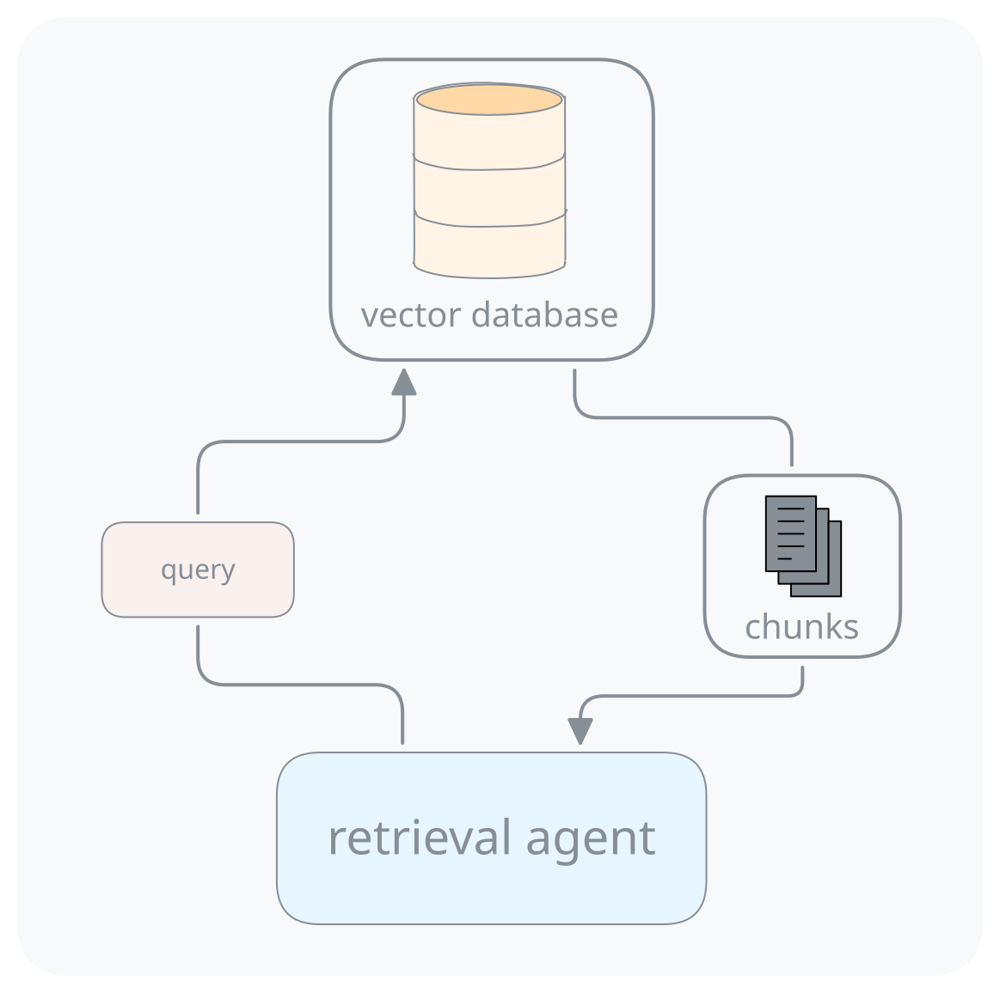

# Vector databases

A vector database holds chunks of text with their vectors. A node searches it, and the chunks found go into its
prompt where it writes `{{chunks}}` (see [prompts](prompts.md#chunks)). Vector databases are declared in
`external.vectordb`, each with an `id`; a node, or a validation node, lists the ones it searches in its
`external.vectordb`. Every key is described in [the reference](graph.md).



```yaml
external:
  vectordb:
    - id: docs
      provider: qdrant
      url: http://localhost:6333
      collection: docs
      text_field: text
      embedding: embedder

graph:
  nodes:
    - id: analyst
      external:
        vectordb:
          - id: docs
            query: user_message
```

## Providers

| `provider` | The search | The text of a chunk | The header of `api_key` |
|---|---|---|---|
| `qdrant` | `POST <url>/collections/<collection>/points/query` | the field `text_field` of the payload; `text_field` is mandatory | `api-key` |
| `chromadb` | `GET <url>/api/v2/tenants/<tenant>/databases/<database>/collections/<collection>`, for the id of the collection, then `POST` on `.../collections/<id>/query` | the documents of the collection; `text_field` is not allowed | `x-chroma-token` |

- `url` and `collection` are mandatory. The host of `url`, on its port, must be in `allowed_hosts` (see
  [the file](file.md#network)).
- `tenant` and `database` are for `chromadb` only: `default_tenant` and `default_database` when they are not written.
- `api_key` is optional. Its variable is read when the database is searched, during the run: a variable that is not
  set fails the node (`io`). On [the service](serve.md#a-graph-from-outside) it must be listed in `allowed_env` for the
  `url`.

## A search

For every vector database of the node, in the order the node lists them:

1. The query is the message of the user (`query: user_message`) or a fixed text written in the file. With
   `user_message`, a node that has no message of the user fails (`missing_field`). Which message it is, when the node
   has input utilities, is explained in [nodes](nodes.md#the-run-of-a-node).
2. The utilities of `utility.query` change the query.
3. The embedding model of the database turns the query into a vector (see [embeddings](embeddings.md)).
4. The database gives back the `top_k` chunks nearest to the vector (5 when it is not written), the nearest first.
   With `chromadb`, a document that is not a text is left out.
5. The utilities of `utility.chunks` change each chunk.

The chunks of all the databases, joined with an empty line between them, are the value of `{{chunks}}`. Each search is
a `read.vectordb` event (see [observability](observability.md)).

## Errors

A search fails the node (`io`) when a request to the database does not end within `timeout` seconds (60 when it is
not written, at least 1; `chromadb` makes two requests for each search), when the server cannot be reached, when it
answers a status other than 2xx, and when its answer is not JSON or lacks what is read in it (`result.points` and the
text of each point with `qdrant`; the `id` of the collection and `documents` with `chromadb`). For a status other than 2xx, the first 500 characters of the body are the `detail` of
the error, written only as the passport allows (see [observability](observability.md)). An error of the embedding
model fails the node with `model_failed`.

A memory with `provider: vectordb` cites a vector database with `ref`: it cannot run yet (see [memory](memory.md)).
