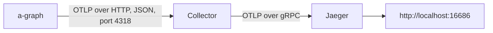

# Observability: a sequence and a react, in Jaeger

A graph with a sequence and a `react`, whose trace goes to a local OpenTelemetry Collector and from there to Jaeger,
a viewer of traces:



`framer` states the task, the controller `editor` calls the workers `explainer` and `critic` until it is done, and
`summarizer` shortens its final answer. What each part does is explained in [the examples](../../docs/examples.md).

## Running it

You need Docker with Compose, `a-graph` (see [the README](../../README.md#build)) and Ollama with `qwen3.5:4b`. From
the root of the repository:

```sh
ollama pull qwen3.5:4b
docker compose -f examples/03-observability/compose.yml up -d
```

Wait until the Collector says `Everything is ready` in
`docker compose -f examples/03-observability/compose.yml logs collector`, then run the graph:

```sh
mkdir -p target/o11y
a-graph examples/03-observability/graph.yml "What is a mutex?" \
  > target/o11y/result.json 2> target/o11y/events.ndjson
```

The result goes to `result.json`, and the JSON log, one event per line, to `events.ndjson`.

## Reading the trace

Open <http://localhost:16686>, choose the service `observability` and look for its traces; the Collector sends them
on within a few seconds. The trace of a run has a span for the run, for every node and for the `react`; inside each
node a span `model local` for each call to the model, and inside `node editor` a span `structured valid` for each
routing answer. A model span holds the provider, the model that answered, the tokens, the prompts and the answer,
and `server.address`, `server.port`, `url.scheme`, `http.request.method` and `http.response.status_code` of its
request.

The `trace_id` of the log leads to the same trace:

```sh
TRACE_ID=$(jq -r 'select(.code == "run.start") | .trace_id' target/o11y/events.ndjson)
curl --fail "http://localhost:16686/api/traces/$TRACE_ID"
```

or, in the browser, `http://localhost:16686/trace/<the trace_id>`.

A trace that does not arrive is written in the log or on the standard error: a run that ended well does not mean
that its trace was delivered.

## What it does and does not do

- Only the trace goes to the Collector. The JSON log stays in the local file: it is not in the format of the logs of
  OpenTelemetry, and must not be sent to the Collector. Nothing sends metrics.
- The passport says the data are `public` and the graph sets `trace.capture_content: true`, so the prompts and the
  answers go into the trace, at most 4096 bytes each. Outside this example the default is no content; with data that
  are not public, the contents are left out.
- The Collector (port 4318) and Jaeger (port 16686) listen only on `127.0.0.1`, without authentication or TLS: it is
  a local example, not the configuration of a service.
- Jaeger keeps at most 1000 traces in memory, and loses them when it restarts. The Collector may use 256 MiB and
  Jaeger 512 MiB. The images are pinned by version.

To stop it:

```sh
docker compose -f examples/03-observability/compose.yml down
```
